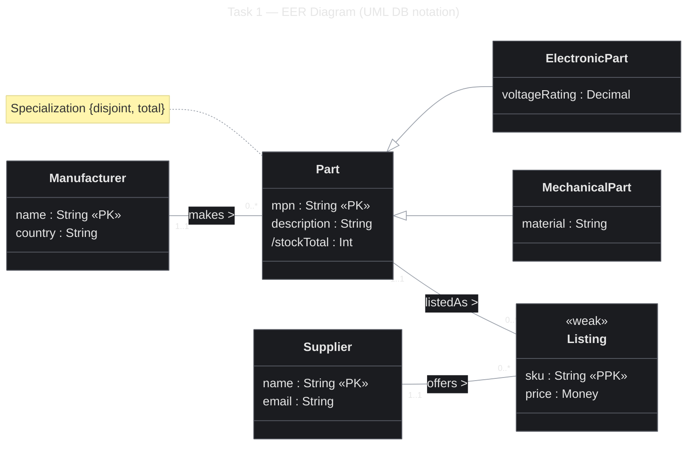
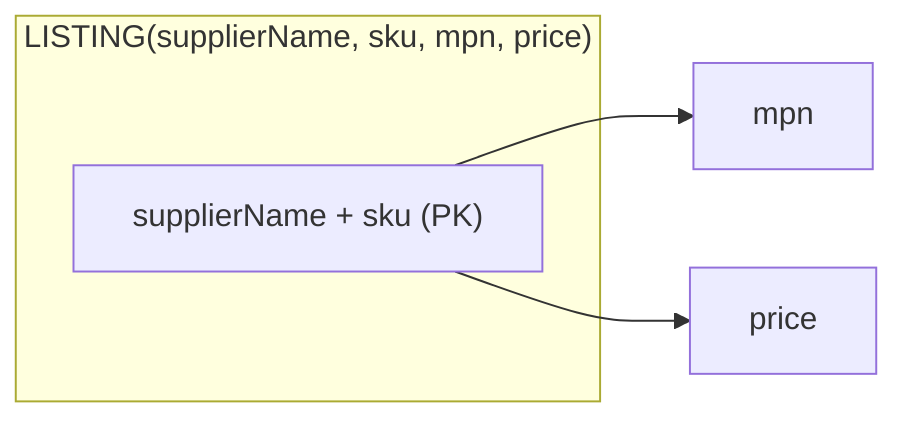

# AGENTS.md — AISE 3309A Assignment 2 (Group Submission)

Context file for AI agents helping with this assignment. Read fully before generating anything.

## Project

- **Course:** AISE 3309A — Database Management Systems (Western University, Fall 2026)
- **Group:** Lab 2 — AISE 3309A 002 LAB FW26, Group 6
- **Members:** Mats Leis (leader, submits), Samuel Huang, Shaan Wrench, Anish Jami, Ayman Hossain
- **Topic:** Engineering Part Sourcer (TA-approved topic from Assignment 1)
- **Series:** Assignments 1–4 build one DBMS. A2's schema is the foundation for A3 (SQL implementation) and A4 (application). Get it right.

## Deadlines

| Stage | Window |
|---|---|
| Create (submit PDF) | Oct 28 – **Sun Nov 15, 11:59 PM** (includes 48h grace) |
| Evaluate (peer review) | Nov 16 2:00 AM – Nov 18 11:59 PM |
| Feedback | Nov 19 1:59 AM – Nov 21 11:58 PM |

Late: −10%/day, max 3 days, then not accepted.

## Deliverable

- **One PDF** (no Word docs), submitted by the group leader on Kritik / OWL.
- Use the course's requirements-specification document template.
- All diagrams must be **computer-generated**: no hand-drawn images. **This group makes every diagram in Mermaid** (see "Diagrams in Mermaid" below), renders it to PNG/SVG, and puts the image in the PDF.
- Keep the `.mmd` source for every diagram in the shared folder (`diagrams/`), so anyone can re-render after a change and A3/A4 can reuse them.

## Task 1 — Conceptual Model (ER Diagram)

- ER diagram in **UML Database notation** (as taught in lectures).
- **Exactly 6–7 entity types.**
- Use **Enhanced ER** features (specialization/generalization, disjoint/overlapping, total/partial participation, etc.) where appropriate.
- Only give an entity an ID if the real-world thing actually has one (e.g. manufacturer part number, SKU). **Do not add arbitrary surrogate IDs everywhere.**
- Show multiplicities/cardinalities and constraints on all relationships.
- Submit the final version only — no drafts.

## Task 2 — Conceptual → Relational

- Translate the ERD to a relational schema following the **lecture transformation steps** (strong entities, weak entities, 1:1, 1:N, M:N, multivalued attributes, specialization/generalization).
- Use the **formal notation from class** for each relation.
- For every relation identify: **primary key, foreign keys, alternate (candidate) keys, derived attributes** (if any).
- Every FK must reference a valid PK (referential integrity).

## Task 3 — Schema Evaluation

**3.3.1 Flaws & 3NF**
- Critically assess the schema for flaws/redundancy/anomalies.
- Show **every relation** is at least 3NF; demonstrate the normalization (list functional dependencies, check 1NF → 2NF → 3NF) with computer-made diagrams (e.g. FD diagrams).

**3.3.2 Combining relations**
- Identify relations that could be merged without adding redundancy, or explicitly state no such opportunity exists.

**3.3.3 BCNF**
- Identify relations not in BCNF (determinant that isn't a superkey). Decide whether to decompose; if all are BCNF, justify it.
- For every combine/decompose decision, justify with **anticipated common queries** and how the design serves them.

---

## Diagrams in Mermaid

Three kinds of diagram are needed, one per task. Each uses a different Mermaid diagram type, because the tasks need different notation.

| Task | What it shows | Mermaid type | Why this type |
|---|---|---|---|
| Task 1 | Conceptual EER model | `classDiagram` | Gives **UML** notation: class boxes, `"1..1"` / `"0..*"` multiplicities, `<|--` generalization arrows. **Do not use `erDiagram` for Task 1**: it draws crow's-foot (IE) notation, not the UML DB notation the rubric asks for. |
| Task 2 | Relational schema (supporting figure) | `flowchart LR` with HTML-table node labels | The only Mermaid type that can colour **individual rows** and **individual lines**, which the colour-coding scheme needs (`erDiagram` can't do either). The formal text notation from class is still required; the diagram supports it and does not replace it. |
| Task 3.3.1 | Functional dependency diagrams | `flowchart LR` | One FD diagram per relation: determinant node(s) → dependent attribute nodes. |

### Style guideline: PlanetScale "Schema design 101"

Reference: https://planetscale.com/blog/schema-design-101-relational-databases (and the reference image the group agreed on: dark tables, coloured key rows, coloured connector lines).

**Follow from it:**
- Its design process: business needs → entities → properties (attributes) → relationships. Use the same order when building the ERD from Assignment 1.
- Its diagram style: each entity/table is a rectangle with the name on top and its properties listed with their types underneath.
- Relationships drawn as **colour-coded lines connecting each primary key to the foreign keys that reference it**.
- Its key definitions: each table has a primary key; when that key appears in another table it is a foreign key there; the child table holds the parent's key.

**Do not follow from it:**
- Its advice to create primary keys by generating a value or using an auto-incrementing integer. **This course wants real-world identifiers** (MPN, SKU, etc.); surrogate IDs are only allowed where nothing real exists, and must be justified in the report.
- "One unique identifying property" per table. Weak entities, M:N relations and multivalued-attribute relations have **composite** keys, which is correct.
- Its inconsistent naming (`customers` vs `Orders`). Use one convention: `PascalCase` classes in Task 1, `UPPER_CASE` relations in Task 2, `camelCase` attributes everywhere.
- It doesn't cover normalization, 1:1, M:N or junction tables; take those from the lecture slides.

### Colour-coding scheme (applies to Task 1 AND Task 2)

The point of the colours: a reader can follow a key from where it is defined to everywhere it is used, in both diagrams.

1. **Colour = a referenced key.** A table gets its own colour only if its primary key is referenced by a foreign key somewhere. That PK row is drawn in the colour.
2. **FK takes the colour of the PK it references.** Every FK row is drawn in the colour of the table it points to, and the connector line between them is that same colour. (In the reference image, `customerID` is orange in both Customers and Orders, joined by an orange line.)
3. **Keys nobody references stay white**, like `orderID` in the reference image. Non-key attributes are always white.
4. **PK + FK in one column** (weak entity owner key, M:N relation, subclass table): use the colour of the table it references.
5. **The same entity has the same colour in both diagrams.** In Task 1, the entity's border is its colour; every association line takes the colour of the **"1" side entity** (the side whose key becomes the FK in Task 2); generalization arrows and subclass borders take the superclass colour. M:N associations take the colour of one participant; in Task 2 the junction relation then has two FKs in two colours.
6. **Never rely on colour alone.** Keep the `PK` / `FK` / `AK` text labels on every key row, so the diagrams still read correctly in greyscale or for colour-blind readers.
7. **Add a colour legend** under each diagram in the report (e.g. "Orange = MANUFACTURER.name, Blue = PART.mpn, …").

**Palette** (bright on the dark background `#1b1c20`; assign in order, max 7 since we have at most 7 entities):

| # | Colour | Hex |
|---|---|---|
| 1 | Orange | `#ff7a1a` |
| 2 | Blue | `#3cb4ff` |
| 3 | Purple | `#a78bfa` |
| 4 | Green | `#4ade80` |
| 5 | Yellow | `#facc15` |
| 6 | Pink | `#f472b6` |
| 7 | Teal | `#2dd4bf` |

Record the final entity → colour mapping here once the ERD is agreed:

| Entity / relation | Colour |
|---|---|
| _TBD after ERD meeting_ | |

### Task 1: `classDiagram` rules (UML DB notation)

- One `class` per entity type. **Count them: must be 6 or 7.** Subclasses of a specialization count as entity types.
- Attributes as `name : Type`. Mark identifiers with stereotypes inside the attribute text: `«PK»` for the real-world identifier, `«PPK»` (partial key) for a weak entity's discriminator. Derived attributes start with `/` (e.g. `/stockTotal : Int`). Multivalued attributes: `[*]` after the type (e.g. `phone : String[*]`).
- **Do not use `{PK}` inside a class block**: the braces conflict with the block syntax. Use `«PK»`.
- Weak entity: add `<<weak>>` as the first line inside the class, and show its identifying relationship to the owner with `"1..1"` on the owner side.
- Every association has **multiplicities on both ends** and a label: `A "1..1" -- "0..*" B : verb >`.
- Specialization: `Super <|-- Sub` for each subclass, plus a note with the constraints, because Mermaid can't draw the UML `{d}`/`{o}` circle: `note for Super "Specialization {disjoint, total}"` (or `{overlapping, partial}` etc.).
- M:N with its own attributes: model as an association class joined with a dotted link (`A .. AssocClass`), or as an explicit class; say which in the report.

**Colouring a `classDiagram`:** `classDiagram` does not support `linkStyle`, and `classDef` gets overridden by the theme, so colours go in `themeCSS` in the front-matter:
- Entity border: `g.node[id*="classId-Part-"] path { stroke: #3cb4ff !important; stroke-width: 2.5px !important; }`
- Association line: `path[id*="_Manufacturer_Part_"] { stroke: #ff7a1a !important; stroke-width: 3px !important; }`. The edge id is `id_<First>_<Second>_<n>` **in the order the two classes are written in that line**; check the SVG if a line doesn't colour.
- Multiplicities default to faint grey on dark: always include `.edgeTerminals text, .edgeTerminals span { fill: #ffffff !important; color: #ffffff !important; }`. Don't change their font size; bigger text gets clipped (`1..1` renders as `1 1`).
- Don't set a monospace `fontFamily` on class diagrams: the box sizing breaks and attributes overlap.
- Avoid entity names where one ends with another (`Part` / `ElectronicPart` is fine because the selector includes the leading `-` or `_`, but double-check the render).

Example (**illustrative only, not our model**: entity names, attributes and count must come from Assignment 1):



### Task 2: colour-coded relational schema (`flowchart` + HTML tables)

- One node per relation. Node id and heading in `UPPER_CASE`, **matching the relation names in the formal notation exactly**.
- The label is an HTML table with three columns: attribute, type, key (`PK`, `FK`, `AK`, `PK, FK`, or empty). Derived attributes, if stored, get `derived` in the key column.
- Colour a key row by giving the `<tr>` a class: `k-orange`, `k-blue`, `k-purple`, `k-green`, `k-yellow`, `k-pink`, `k-teal` (defined once in `themeCSS`, see the example).
- One edge per FK, written `PARENT --- CHILD`, then `linkStyle <n> stroke:<hex>,stroke-width:3px` with the PK's colour. **`linkStyle` numbers edges from 0 in the order they're written**, so keep the edge lines and `linkStyle` lines in the same order.
- **Write each node's label on a single line.** Line breaks inside the label become blank space at the top of the box.
- Needs `flowchart: htmlLabels: true` in the config (in the example).
- Render with the dark background: `-b "#1b1c20"`.

```mermaid
---
title: Task 2 — Relational schema
config:
  theme: base
  themeVariables:
    background: "#1b1c20"
    primaryColor: "#1b1c20"
    primaryBorderColor: "#5a5d66"
    primaryTextColor: "#e6e6e6"
    lineColor: "#5a5d66"
    fontFamily: "monospace"
  themeCSS: >
    .nodeLabel table { border-collapse: collapse; margin-top: 6px; }
    .nodeLabel td { text-align: left; padding: 3px 12px; font-family: monospace; border-top: 1px solid #3a3d44; }
    .nodeLabel td + td { border-left: 1px solid #3a3d44; }
    .k-orange { color: #ff7a1a; } .k-blue { color: #3cb4ff; } .k-purple { color: #a78bfa; } .k-green { color: #4ade80; }
    .k-yellow { color: #facc15; } .k-pink { color: #f472b6; } .k-teal { color: #2dd4bf; }
  flowchart:
    htmlLabels: true
    curve: step
    wrappingWidth: 600
---
flowchart LR
    MANUFACTURER["<b>MANUFACTURER</b><table><tr class='k-orange'><td>name</td><td>VARCHAR</td><td>PK</td></tr><tr><td>country</td><td>VARCHAR</td><td></td></tr><tr><td>website</td><td>VARCHAR</td><td>AK</td></tr></table>"]
    PART["<b>PART</b><table><tr class='k-blue'><td>mpn</td><td>VARCHAR</td><td>PK</td></tr><tr class='k-orange'><td>mfrName</td><td>VARCHAR</td><td>FK</td></tr><tr><td>description</td><td>TEXT</td><td></td></tr></table>"]
    SUPPLIER["<b>SUPPLIER</b><table><tr class='k-purple'><td>name</td><td>VARCHAR</td><td>PK</td></tr><tr><td>email</td><td>VARCHAR</td><td>AK</td></tr></table>"]
    LISTING["<b>LISTING</b><table><tr class='k-purple'><td>supplierName</td><td>VARCHAR</td><td>PK, FK</td></tr><tr><td>sku</td><td>VARCHAR</td><td>PK</td></tr><tr class='k-blue'><td>mpn</td><td>VARCHAR</td><td>FK</td></tr><tr><td>price</td><td>DECIMAL</td><td></td></tr></table>"]
    MANUFACTURER --- PART
    PART --- LISTING
    SUPPLIER --- LISTING
    linkStyle 0 stroke:#ff7a1a,stroke-width:3px
    linkStyle 1 stroke:#3cb4ff,stroke-width:3px
    linkStyle 2 stroke:#a78bfa,stroke-width:3px
    classDef table fill:#1b1c20,stroke:#5a5d66,stroke-width:2px,rx:10,ry:10
    class MANUFACTURER,PART,SUPPLIER,LISTING table
```



Note how the example follows the colour rules: `sku` is part of LISTING's key but stays white because nothing references LISTING; `supplierName` is purple because it references SUPPLIER.

### Task 3.3.1: `flowchart` FD diagram rules

- One diagram (or one `subgraph`) per relation. **Every relation in Task 2 gets one**, including the all-key ones (show "PK → nothing else; trivially BCNF").
- The determinant is a single node showing the full key (`"supplierName + sku (PK)"`); arrows go to each dependent attribute.
- Partial dependencies (part of a composite key → attribute) and transitive dependencies (non-key → non-key) get their own arrows from their own determinant node and a dashed style (`-.->`), so the 2NF/3NF violation is visible at a glance. If the final schema has none, say so under the diagram.
- Same dark theme as the other diagrams for a consistent look; the determinant node can use its relation's colour from the scheme.



### Rendering

```bash
npm install -g @mermaid-js/mermaid-cli
mmdc -i diagrams/task1_eer.mmd -o diagrams/task1_eer.png -s 3 -b "#1b1c20"
```

- `-s 3` renders at 3× scale so text stays sharp in the PDF.
- `-b "#1b1c20"` matches the dark theme; without it the area around the diagram is white.
- If Chromium complains about sandboxing, add `-p puppeteer.json` with `{"args":["--no-sandbox"]}`.
- The Mermaid Live Editor (mermaid.live) works too for quick previews; export as PNG or SVG.
- Open every rendered image and check it: labels not overlapping, multiplicities readable, every line the right colour, nothing cut off. If the layout is messy, try `direction TB` vs `direction LR`.

---

## Alignment double-check (run after every diagram change and before submitting)

An agent producing or editing any diagram must run this whole checklist and report each item as pass/fail with a one-line reason. Do not mark the work done while any item fails.

**A. Against Assignment 1**
- [ ] Every entity traces back to something in A1's project overview / functional specs. Nothing invented that A1 doesn't support; nothing in A1's core functions left without somewhere to store its data.
- [ ] Topic is still Engineering Part Sourcer as approved by the TA.

**B. Task 1 (EER, UML notation)**
- [ ] Entity type count is **6 or 7** (count the classes; state the number).
- [ ] Drawn with `classDiagram` (UML), not `erDiagram` (crow's foot).
- [ ] Every association has multiplicities on **both** ends and a name.
- [ ] At least one EER feature is used where it makes sense, and every specialization has its `{disjoint|overlapping, total|partial}` note.
- [ ] Identifiers: only real-world IDs (MPN, SKU, etc.). Flag any `xxxID` that's a made-up surrogate.
- [ ] Weak entities have `<<weak>>`, a partial key, and an identifying relationship to their owner.
- [ ] Derived attributes marked `/`, multivalued marked `[*]`.

**C. Task 2 (relational schema)**
- [ ] Each lecture transformation step was applied and the report says which step produced which relation (strong, weak, 1:1, 1:N, M:N, multivalued, specialization).
- [ ] Every relation lists PK, FKs, alternate keys, and derived attributes (or "none").
- [ ] **Every FK references an existing PK** with a matching type. List each FK → target to prove it.
- [ ] Every M:N became its own relation; every multivalued attribute became its own relation.
- [ ] The colour-coded schema figure and the formal notation contain exactly the same relations and attributes.

**D. Task 3 (normalization)**
- [ ] One FD diagram for **every** relation in Task 2, no relation skipped.
- [ ] 1NF → 2NF → 3NF argued per relation; no partial or transitive dependency left unexplained.
- [ ] 3.3.2 names specific merge candidates or states clearly that none exist, with reasons.
- [ ] 3.3.3 checks every determinant is a superkey; each decompose/keep decision is tied to a named common query (e.g. "find the cheapest supplier for MPN X").

**E. Colour coding**
- [ ] Every PK that is referenced has a colour; every FK row and its connector line use the colour of the PK it references.
- [ ] Unreferenced keys and all non-key attributes are white.
- [ ] Each entity has the same colour in Task 1 and Task 2, matching the mapping table in this file.
- [ ] Task 1 association lines use the "1" side's colour; generalization arrows use the superclass colour.
- [ ] `PK`/`FK`/`AK` text labels are still on every key row; a colour legend is under each diagram.
- [ ] No more than 7 colours, all from the palette.

**F. Consistency across the whole report**
- [ ] Names are spelled identically in the ERD, the formal schema, the schema figure, the FD diagrams and the prose (case conventions aside: `Part` class → `PART` table).
- [ ] Every diagram is a computer-rendered image from a `.mmd` file; no drafts in the final PDF.
- [ ] Rendered images checked by eye for readability.
- [ ] Team Contribution Efforts section present and reviewed by all five members.

---

## Team Contribution Efforts

### Planned work split

The plan has one **lead** per part, but every member also contributes to or reviews every part, as the guideline below requires. The leads are a starting allocation; swap them if someone's schedule demands it.

| Member | Lead on | Contributes to / reviews |
|---|---|---|
| **Mats Leis** (leader) | Task 1 EER model (with Shaan); Mermaid setup, colour scheme + rendering; final PDF assembly & submission | Reviews Task 2 transformations; runs the final alignment check |
| **Shaan Wrench** | Task 1 EER model (with Mats): attributes, real-world keys, tracing back to A1 specs | Reviews Task 3.3.1 FD lists; proofreads the report |
| **Samuel Huang** | Task 2: transformation steps, formal notation, PK/FK/AK/derived for every relation; colour-coded schema figure | Reviews Task 1 multiplicities; checks FK → PK list |
| **Anish Jami** | Task 3.3.1: flaws/anomalies, FDs, 1NF→3NF per relation; Mermaid FD diagrams | Reviews Task 2 for missing relations; checks 3.3.3 BCNF reasoning |
| **Ayman Hossain** | Task 3.3.2 combining relations + Task 3.3.3 BCNF; list of anticipated common queries | Cross-report naming consistency pass; reviews Task 1 EER features |

**Collaborative work (all five):**
- ERD review meeting: agree on the final 6–7 entities, specializations and multiplicities before Task 2 starts (Task 2 and 3 depend on it).
- Anticipated common queries brainstorm, which feeds 3.3.2/3.3.3 and later A3.
- Group check of the 3NF/BCNF conclusions.
- Everyone reads the final PDF before Mats submits.

**Suggested internal timeline:**
- Thu Nov 12: Task 1 ERD agreed by the group
- Fri Nov 13: Task 2 schema + colour-coded schema figure done
- Sat Nov 14: Task 3 + FD diagrams done; colour mapping filled in; alignment check run
- Sun Nov 15 (before 11:59 PM): final review, PDF submitted

### Text for the report section

This section is used for grading, so the final version must say **what each person actually did**. Before submitting, each member edits their own bullet to match their real work (add things they took on, remove things they didn't do). An agent must not finalize this section without that confirmation.

Draft (edit to match reality):

- **Mats Leis:** Co-designed the Task 1 EER diagram with Shaan; set up the Mermaid diagram workflow and rendered all figures; assembled and submitted the final PDF; ran the final alignment check. Reviewed Task 2.
- **Shaan Wrench:** Co-designed the Task 1 EER diagram with Mats, focusing on attributes, real-world identifiers and consistency with the A1 functional specs. Reviewed the Task 3.3.1 functional dependencies; proofread the report.
- **Samuel Huang:** Translated the EER model to the relational schema (Task 2) using the lecture transformation steps; identified PK/FK/AK/derived attributes; built the relational schema figure. Reviewed Task 1 multiplicities.
- **Anish Jami:** Wrote Task 3.3.1: identified flaws and anomalies, listed FDs, showed each relation is in 3NF, made the FD diagrams. Reviewed Task 2 for completeness and the BCNF analysis.
- **Ayman Hossain:** Wrote Task 3.3.2 and 3.3.3: combining-relations and BCNF analysis, justified with anticipated common queries. Did the naming-consistency pass across the report; reviewed the Task 1 EER features.
- **All members:** Attended the ERD review meeting, brainstormed common queries, checked the normalization conclusions, and reviewed the final PDF.

---

## Required report sections

1. Task 1: ER diagram (Mermaid `classDiagram`, UML notation, colour-coded to match Task 2)
2. Task 2: Relational schema in formal notation (PK/FK/AK/derived marked) + colour-coded schema figure (Mermaid `flowchart`)
3. Task 3: 3.3.1 / 3.3.2 / 3.3.3 with written justifications + Mermaid FD diagrams
4. **Team Contribution Efforts**: short bullets per member (used for fair grading)

## Rubric (9 criteria, equal weight)

- T1: Model Correctness · Relationships & Constraints · Attribute & Key Logic
- T2: Accurate Translation · Referential Integrity · Schema Completeness
- T3: Schema Flaws & 3NF Evaluation · Opportunities for Combining Relations · BCNF Evaluation

## Agent guidelines

- Stay consistent with Assignment 1's project overview and functional specs; ask for that doc if not provided. **Do not invent the entity list**: the Mermaid examples above are syntax illustrations only.
- Keep attribute and relation names consistent between ERD, schema, and report.
- Flag entity count outside 6–7, arbitrary IDs, missing FKs, or any transitive/partial dependency.
- Diagrams: **Mermaid**, using the diagram type per task in the table above, with the colour-coding scheme on Task 1 and Task 2. Render and look at the output before calling it done.
- Use the PlanetScale article for diagram style only; its surrogate-key advice conflicts with this course's rules (see "Style guideline").
- Run the **Alignment double-check** after any diagram change and report results item by item.
- Every team member should contribute to every part — don't produce the whole thing for one person to paste in without the group reviewing it.
- Never finalize the Team Contribution Efforts text on someone's behalf: the bullets must reflect what each member confirms they did.