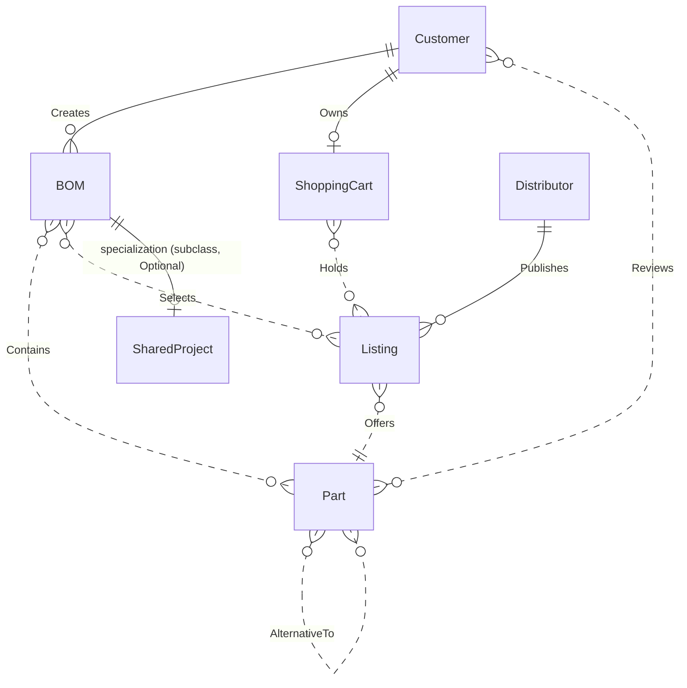

# Assignment 2 diagrams as text

_Generated by `python export_schema.py` from `build_report.py`. Do not edit by hand._

## Figure 1: ER diagram (`erd_engineering_part_sourcer.svg`)

**Notation:** {PK} primary key     {AK} alternate key | Two {PK} attributes form one composite key | {PPK} partial key of a weak entity | /Attr   derived attribute | Indented attributes are parts of a composite | 0..*   multiplicity (min..max) | Dashed box: attributes of the relationship | Composition (identifying relationship) | Specialization, points to the superclass

**Reading multiplicities:** The multiplicity at an end is how many instances of THAT end's entity relate to ONE instance of the other end. Customer 1..1 / BOM 0..* means every BOM has exactly one Customer and a Customer has zero or more BOMs.

### Entities

- **Customer** (Strong; identifier: Email {PK}; Username {AK}): Email {PK}; Username {AK}; Password; Name = (FirstName, LastName); BillingAddress = (HouseAddress, UnitNum, City, Province, Country, PostCode)
- **BOM** (Weak (owner: Customer); identifier: BOM_name {PPK}): BOM_name {PPK}; Date_created; /NumberOfParts; /UnpricedParts; /TotalCost
- **SharedProject** (Subclass of BOM; identifier: Inherited from BOM; Title {AK} per owner): Title {AK}; Description; Date_shared
- **ShoppingCart** (Weak (owner: Customer); identifier: None): Date_created; /Subtotal; /ShippingPrice; /TotalPrice
- **Distributor** (Strong; identifier: Name {PK}; Website {AK}): Name {PK}; Website {AK}; ShippingFee
- **Listing** (Weak (owner: Distributor); identifier: Distributor_PartNum {PPK}): Distributor_PartNum {PPK}; Packaging; UnitPrice; StockQuantity; EstShipTime; LastUpdated
- **Part** (Strong; identifier: (ManufacturerName, Manufacturer_PartNum) {PK}): ManufacturerName {PK}; Manufacturer_PartNum {PK}; Name; Description; Category; Dimensions = (Length, Width, Height); Datasheet_link; /AvgStarRating

### Relationships

- **Customer Creates BOM** [1..1 to 0..*]: each BOM has exactly one Customer; each Customer has zero or more BOM. (identifying / composition)
- **Customer Owns ShoppingCart** [1..1 to 0..1]: each ShoppingCart has exactly one Customer; each Customer has zero or one ShoppingCart. (identifying / composition)
- **Customer Reviews Part** [0..* to 0..*]: each Part has zero or more Customer; each Customer has zero or more Part. (attributes: ReviewText, StarRating)
- **Distributor Publishes Listing** [1..1 to 0..*]: each Listing has exactly one Distributor; each Distributor has zero or more Listing. (identifying / composition)
- **Listing Offers Part** [0..* to 1..1]: each Part has zero or more Listing; each Listing has exactly one Part.
- **Part AlternativeTo Part** [0..* to 0..*]: each Part has zero or more Part; each Part has zero or more Part.
- **BOM Contains Part** [0..* to 0..*]: each Part has zero or more BOM; each BOM has zero or more Part. (attributes: Quantity)
- **BOM Selects Listing** [0..* to 0..*]: each Listing has zero or more BOM; each BOM has zero or more Listing.
- **ShoppingCart Holds Listing** [0..* to 0..*]: each Listing has zero or more ShoppingCart; each ShoppingCart has zero or more Listing. (attributes: Quantity)
- **SharedProject is a subclass of BOM**: {Optional}: a BOM does not have to be shared. Subclass adds Title, Description, Date_shared.

## Figure 2: Referential integrity (`schema_foreign_keys.svg`)

Each arrow goes from a foreign key to the relation whose primary key it references. All FK columns are NOT NULL and use ON UPDATE CASCADE.

| Relation | Foreign key | References | ON DELETE | Implements |
|---|---|---|---|---|
| Listing | DistributorName | Distributor(Name) | CASCADE | Publishes |
| Listing | ManufacturerName, Manufacturer_PartNum | Part(ManufacturerName, Manufacturer_PartNum) | RESTRICT | Offers |
| ShoppingCart | CustomerEmail | Customer(Email) | CASCADE | Owns |
| BOM | CustomerEmail | Customer(Email) | CASCADE | Creates |
| SharedProject | CustomerEmail, BOM_name | BOM(CustomerEmail, BOM_name) | CASCADE | Specialization |
| PartAlternative | Part1_ManufacturerName, Part1_PartNum | Part(ManufacturerName, Manufacturer_PartNum) | CASCADE | AlternativeTo |
| PartAlternative | Part2_ManufacturerName, Part2_PartNum | Part(ManufacturerName, Manufacturer_PartNum) | CASCADE | AlternativeTo |
| BOMLine | CustomerEmail, BOM_name | BOM(CustomerEmail, BOM_name) | CASCADE | Contains |
| BOMLine | ManufacturerName, Manufacturer_PartNum | Part(ManufacturerName, Manufacturer_PartNum) | RESTRICT | Contains |
| BOMSelection | CustomerEmail, BOM_name | BOM(CustomerEmail, BOM_name) | CASCADE | Selects |
| BOMSelection | DistributorName, Distributor_PartNum | Listing(DistributorName, Distributor_PartNum) | CASCADE | Selects |
| CartLine | CustomerEmail | ShoppingCart(CustomerEmail) | CASCADE | Holds |
| CartLine | DistributorName, Distributor_PartNum | Listing(DistributorName, Distributor_PartNum) | CASCADE | Holds |
| Review | CustomerEmail | Customer(Email) | CASCADE | Reviews |
| Review | ManufacturerName, Manufacturer_PartNum | Part(ManufacturerName, Manufacturer_PartNum) | CASCADE | Reviews |

## FD diagrams (`fd_<Relation>.svg`, section 3.3.1)

In each diagram the shaded, underlined cells are the primary key; a dot marks a determinant attribute and an arrow points to each dependent.

### Customer
- Attributes: Email, Username, Password, FirstName, LastName, HouseAddress, UnitNum, City, Province, Country, PostCode
- Candidate keys: {Email}; {Username}
- FD1: Email -> Username, Password, FirstName, LastName, HouseAddress, UnitNum, City, Province, Country, PostCode  (determinant is PK)
- FD2: Username -> Email, Password, FirstName, LastName, HouseAddress, UnitNum, City, Province, Country, PostCode  (determinant is AK)
- BCNF: yes

### Part
- Attributes: ManufacturerName, Manufacturer_PartNum, Name, Description, Category, Length, Width, Height, Datasheet_link
- Candidate keys: {ManufacturerName, Manufacturer_PartNum}
- FD1: (ManufacturerName, Manufacturer_PartNum) -> Name, Description, Category, Length, Width, Height, Datasheet_link  (determinant is PK)
- Derived, not stored: /AvgStarRating = AVG(Review.StarRating) over the part's reviews (no value when the part has no review)
- BCNF: yes

### Distributor
- Attributes: Name, Website, ShippingFee
- Candidate keys: {Name}; {Website}
- FD1: Name -> Website, ShippingFee  (determinant is PK)
- FD2: Website -> Name, ShippingFee  (determinant is AK)
- BCNF: yes

### Listing
- Attributes: DistributorName, Distributor_PartNum, ManufacturerName, Manufacturer_PartNum, Packaging, UnitPrice, StockQuantity, EstShipTime, LastUpdated
- Candidate keys: {DistributorName, Distributor_PartNum}; {DistributorName, ManufacturerName, Manufacturer_PartNum, Packaging}
- FD1: (DistributorName, Distributor_PartNum) -> ManufacturerName, Manufacturer_PartNum, Packaging, UnitPrice, StockQuantity, EstShipTime, LastUpdated  (determinant is PK)
- FD2: (DistributorName, ManufacturerName, Manufacturer_PartNum, Packaging) -> Distributor_PartNum, UnitPrice, StockQuantity, EstShipTime, LastUpdated  (determinant is AK)
- BCNF: yes

### ShoppingCart
- Attributes: CustomerEmail, Date_created
- Candidate keys: {CustomerEmail}
- FD1: CustomerEmail -> Date_created  (determinant is PK)
- Derived, not stored: /Subtotal = SUM(CartLine.Quantity × Listing.UnitPrice); 0 for an empty cart
- Derived, not stored: /ShippingPrice = SUM(Distributor.ShippingFee) over the distinct distributors in the cart; 0 for an empty cart
- Derived, not stored: /TotalPrice = /Subtotal + /ShippingPrice (before tax)
- BCNF: yes

### BOM
- Attributes: CustomerEmail, BOM_name, Date_created
- Candidate keys: {CustomerEmail, BOM_name}
- FD1: (CustomerEmail, BOM_name) -> Date_created  (determinant is PK)
- Derived, not stored: /NumberOfParts = COUNT of the BOM's BOMLine rows
- Derived, not stored: /UnpricedParts = COUNT of the BOM's BOMLine rows that have no selected listing
- Derived, not stored: /TotalCost = SUM(BOMLine.Quantity × Listing.UnitPrice) over the lines that have a selected listing. Parts only, without shipping or tax. It is the complete cost of the BOM only when /UnpricedParts = 0; otherwise it is shown as a partial total
- BCNF: yes

### SharedProject
- Attributes: CustomerEmail, BOM_name, Title, Description, Date_shared
- Candidate keys: {CustomerEmail, BOM_name}; {CustomerEmail, Title}
- FD1: (CustomerEmail, BOM_name) -> Title, Description, Date_shared  (determinant is PK)
- FD2: (CustomerEmail, Title) -> BOM_name, Description, Date_shared  (determinant is AK)
- BCNF: yes

### PartAlternative
- Attributes: Part1_ManufacturerName, Part1_PartNum, Part2_ManufacturerName, Part2_PartNum
- Candidate keys: {Part1_ManufacturerName, Part1_PartNum, Part2_ManufacturerName, Part2_PartNum}
- No non-trivial FDs (all-key relation).
- BCNF: yes

### BOMLine
- Attributes: CustomerEmail, BOM_name, ManufacturerName, Manufacturer_PartNum, Quantity
- Candidate keys: {CustomerEmail, BOM_name, ManufacturerName, Manufacturer_PartNum}
- FD1: (CustomerEmail, BOM_name, ManufacturerName, Manufacturer_PartNum) -> Quantity  (determinant is PK)
- BCNF: yes

### BOMSelection
- Attributes: CustomerEmail, BOM_name, DistributorName, Distributor_PartNum
- Candidate keys: {CustomerEmail, BOM_name, DistributorName, Distributor_PartNum}
- No non-trivial FDs (all-key relation).
- BCNF: yes

### CartLine
- Attributes: CustomerEmail, DistributorName, Distributor_PartNum, Quantity
- Candidate keys: {CustomerEmail, DistributorName, Distributor_PartNum}
- FD1: (CustomerEmail, DistributorName, Distributor_PartNum) -> Quantity  (determinant is PK)
- BCNF: yes

### Review
- Attributes: CustomerEmail, ManufacturerName, Manufacturer_PartNum, ReviewText, StarRating
- Candidate keys: {CustomerEmail, ManufacturerName, Manufacturer_PartNum}
- FD1: (CustomerEmail, ManufacturerName, Manufacturer_PartNum) -> ReviewText, StarRating  (determinant is PK)
- BCNF: yes

## Figure 3: BOMLine (merged with BOMSelection) - REJECTED (`fd_BOMLine_merged_alternative.svg`)

- Attributes: CustomerEmail, BOM_name, ManufacturerName, Manufacturer_PartNum, Quantity, DistributorName, Distributor_PartNum
- Primary key: (CustomerEmail, BOM_name, ManufacturerName, Manufacturer_PartNum)
- FD1: (CustomerEmail, BOM_name, ManufacturerName, Manufacturer_PartNum) -> Quantity, DistributorName, Distributor_PartNum
- FD2: (DistributorName, Distributor_PartNum) -> ManufacturerName, Manufacturer_PartNum
- Verdict: In 3NF but not BCNF: FD2's determinant (DistributorName, Distributor_PartNum) is not a superkey. The schema keeps BOMLine and BOMSelection separate.

## Constraints the diagrams cannot show

- **C1**: StarRating is an integer from 1 to 5. Every Quantity is greater than 0. UnitPrice, StockQuantity and ShippingFee are not negative.
- **C2**: A distributor has at most one listing for a given part in a given packaging. The same part can be listed several times by one distributor, once per packaging (for example cut tape and reel), and each of those listings has its own Distributor_PartNum, price and stock.
- **C3**: A BOM selects only listings of parts it contains, and at most one listing for each of those parts.
- **C4**: AlternativeTo is symmetric, and a part is not an alternative to itself.
- **C5**: A SharedProject's BOM contains at least one part at all times.
- **C6**: A customer reviews a part at most once. Purchases are completed on the distributor's own website, so the system does not record them and cannot check that the reviewer bought the part.
- **C7**: The part offered by a listing never changes. An offer for a different part is a new listing.

How C3, C5 and C7 are maintained (triggers):

- **C3** on INSERT or UPDATE on BOMSelection: Rejected unless the listing's part has a BOMLine in the same BOM and the BOM has no other selection for that part.
- **C3** on DELETE on BOMLine: The BOM's selection for that part, if any, is deleted with the line.
- **C3, C7** on UPDATE of the part columns of Listing: Rejected when made directly. A listing never changes its part, so an existing selection cannot start pointing at a different part. The one exception is the ON UPDATE CASCADE from Part when a part's own key is corrected: the listing still refers to the same part.
- **C3** on DELETE on Listing: Its BOMSelection rows are removed by ON DELETE CASCADE. The line stays and counts in /UnpricedParts.
- **C5** on INSERT on SharedProject: Rejected if the BOM has no BOMLine.
- **C5** on DELETE on BOMLine: Rejected if it is the last line of a shared BOM. The owner must stop sharing the project first. This applies to deleting a line on its own: when the BOM or its customer is deleted, the lines and the SharedProject row are removed together by the cascades.
